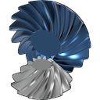

# Spiral Bevel

A Fusion add-in with one command, **Spiral Bevel Gear** (Solid → Create): a
**spiral bevel pinion** and the **bevel gear** it drives, placed on any flat face
or construction plane - or continuing an existing helical gear, so one shaft can
mesh with a crossed helical gear *and* turn a second shaft through a bevel pair.



## What you set

| | |
|---|---|
| **Place on** | a flat face (the pinion is centred on it) or a construction plane (on its origin). The pinion grows along the normal, away from the face; **Flip direction** reverses it. |
| **Keep clear of** (optional) | end faces of other gears turning next to the pair. Each is checked as the cylinder its teeth sweep over a full turn. |
| **Define by** | *Tooth counts* - pinion and gear teeth, e.g. 12 : 25, and the cone angles follow from the ratio and the shaft angle, `tan d1 = sin S / (z2/z1 + cos S)`. Or *Pinion teeth + cone angle* - the gear's count then follows, rounded, and the dialog shows the cone angle actually built. |
| Shaft angle | 90 deg by default. |
| Normal module, pressure angle, spiral angle, pinion hand, backlash, face width | the tooth system. Face width 0 = a third of the cone distance, the usual limit. |
| **Neck (gap)** | a neck between the base and the pinion's heel, no wider than the base gear's root less 0.25 mn clearance. |
| **Gear position** | where the gear sits round the pinion axis. |
| Replace the pair made before | re-running swaps the old pair for the new one, so trying counts and angles is quick. |
| Preview | the pair, live, in the same transparent cyan glass Horological Gears uses. |

### What a gear's end face adds over any flat face

Nothing is required of it - but when the face you place on is a gear's end face
(an outline of 8 or more teeth, under 30 % deep), the dialog says so and:

- if its tooth count equals the pinion's, the pinion's teeth are **lined up with
  its teeth**, tooth for tooth - that is what makes the pinion a continuation of
  a helical gear (keep the module, pressure angle and helix = spiral angle and
  hand the same);
- its tip cylinder is used to check the bevel **gear** against it, since the two
  turn on different shafts.

A face, a plane or a gear face all give the same axis and centre; only the tooth
line-up and that one clearance need the teeth.

## Why there is a gap

When the pinion continues a helical gear that meshes with a crossed helical
(pick that one's end face under **Keep clear of**): the crossed gear sweeps its tip circle across the whole width of the gear
it meshes with - and past its end faces, because that circle's radius (2.64 mm
here) is far bigger than the gear is thick (0.5 mm). A pinion that starts right
at the end face runs into it. The dialog computes, live, the gap needed at the
current layout. With the screenshot's gears, a same-size partner and its
mid-plane through the middle of the helical face:

| pinion cone | gear teeth | gap needed | gear clear of B, placed opposite |
|---|---|---|---|
| 19.9 deg | 69 | 0.784 mm | 4.68 mm |
| 30.2 deg | 43 | 0.696 mm | 4.39 mm |
| 39.8 deg | 30 | 0.612 mm | 4.24 mm |
| 45.0 deg | 25 | 0.567 mm | 4.19 mm |
| 50.0 deg | 21 | 0.523 mm | 4.16 mm |
| 60.8 deg | 14 | 0.430 mm | 4.10 mm |
| 70.2 deg | 9 | 0.371 mm | 4.08 mm |

A steeper pinion needs less gap and drives a smaller gear. The gear itself is
clear of the other helical from about 90 to 270 deg round the axis measured from
it, and hits it at 0 +- 45 deg. `tools/clearance.py` regenerates this table.

## The two checks

- **Swept volumes (dialog, live).** What a gear occupies over a full turn is a
  solid of revolution, so gears that must not mesh have to keep those apart
  *whatever phase their teeth are at*. The helical gears are taken as their tip
  cylinders, which is what they sweep.
- **Solid bodies (after Create).** Every new body is intersected with every other
  visible body and the volume reported - including pinion against gear, which
  with backlash must be zero; non-zero there would mean the mesh is wrong. This
  is one phase only, so it can miss a clash the swept check catches.

## Tooth form

- Tredgold back-cone sections: each transverse section is the involute of the
  virtual spur gear `r / cos(delta)`, with the transverse pressure angle of a
  helical tooth of the same spiral angle. Second-order error in tooth half-width
  over virtual radius - about 3 % of a module at this size.
- Depth tapers to the apex; root and face cones share the pitch apex.
- **Constant spiral angle** (logarithmic spiral): the only spiral whose azimuth
  rate, `tan(beta)/r` per unit length, matches a helix - which is what makes it a
  continuation. The Gleason face-milled arc has a varying spiral angle and cannot.
- Built as one tooth lofted through nine closed 3D sections, patterned, and joined
  to a revolved blank. Each gear is its own component, parametric in the timeline.
- The section and blank sketches are hidden once the gear is built.
- No fillets; the pinion is not joined into the helical body (use Combine).

## Tests

```
py -3.10 tests/test_math.py       # 68 offline checks, no Fusion
py -3.10 tools/livetest.py        # 34 checks inside a live Fusion
```

The offline tests prove, among others, that the pitch cones **roll without slip
across the whole face** (to 1e-15 mm) while the wrong hand slips 0.25 mm, that
the tooth line keeps 45 deg to the generator everywhere, and that it turns the
way and at the rate of the helix it continues. The live tests build pairs at
several angles, hands and shaft angles and require zero overlap at the design
backlash **and** a non-zero overlap with the teeth fattened - so a zero means
clearance, not gears that are merely apart - and they check the swept numbers
against real solids. Every live job runs in a new document closed unsaved.

## Icon

`tools/make_icons.py` builds the full Fusion icon matrix (16/32/64, @2x, dark,
disabled) from `resources/src/icon_source.png`, a transparent render of a real
12 : 18 pair made by the add-in's `render` dev job - Horological Gears' pipeline,
so the two read as a family. Fusion caches icons: restart it to see new ones.

## Install

`powershell -File install.ps1` copies the add-in into Fusion's AddIns folder.
`sb_core.py` and `sb_math.py` hot-reload on every command; only `SpiralBevel.py`
needs a Stop/Run. The dev bridge is on while a `devbridge.on` file sits next to
the add-in.
